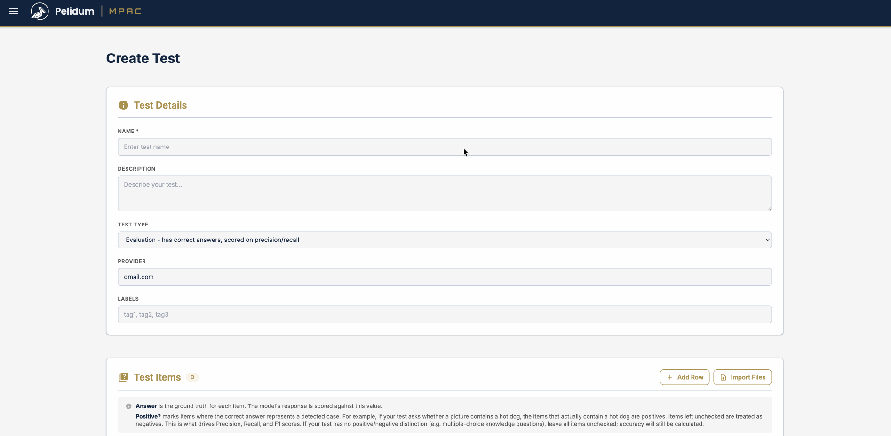
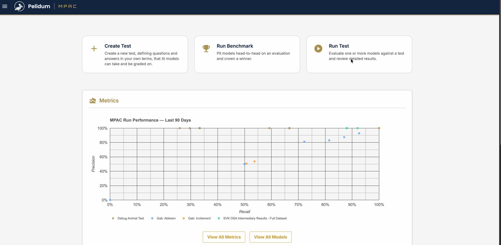
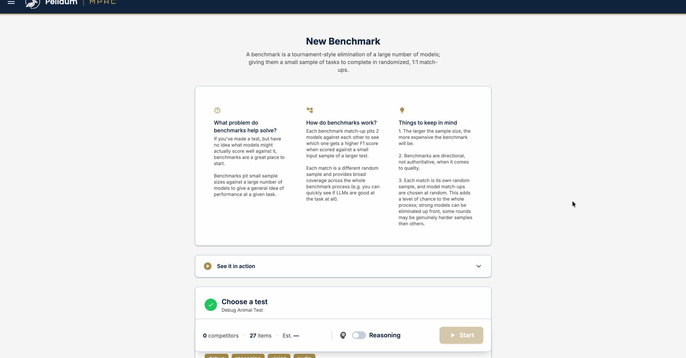

# MPAC

**Multi-Provider Agent Consensus** is a platform for AI model evaluation. It runs the same questions against multiple language models and measures their accuracy.

You can use local models, hosted models, or both. MPAC supports vLLM, Ollama, LM Studio, llama.cpp, OpenAI, and OpenRouter.

## See It Work

**Create a test.** Enter your questions and answers in a spreadsheet editor, and attach images, audio, video, or text.



**Run the test.** Choose your models and watch the run live. When it finishes, compare precision, recall, F1, cost, and speed.



**Run a benchmark.** Put models in a single-elimination tournament to find the best one for your test.



## On-Premises Quickstart

You need one machine with Docker and Terraform 1.7 or later. Ports 80, 443, and 50051 must be free.

**1. Get the code and copy the settings file.**

```bash
git clone https://github.com/pelidum/mpac.git && cd mpac
cp terraform/on_prem/terraform.tfvars.example terraform/on_prem/terraform.tfvars
chmod 600 terraform/on_prem/terraform.tfvars
```

**2. Set your secrets.** In `terraform.tfvars`, replace each of the three `CHANGE_ME` values. To make a random value, run `openssl rand -hex 32`.

**3. Deploy.**

```bash
terraform -chdir=terraform/on_prem init
terraform -chdir=terraform/on_prem apply
```

**4. Sign in.** Open <https://localhost> and accept the self-signed certificate. Sign in as `admin@example.com` with the admin password from step 2.

**5. Add a model backend.** Go to **Admin**, then **Backends**, then **Add Backend**. If the model server is on this machine, use `host.docker.internal` in the URL, not `localhost`.

You can now create a test and run it.

## Key Terms

| Term | Definition |
|------|-----------|
| Test | A named collection of items with metadata and visibility settings |
| Item | A single question with choices and an optional attachment |
| Run | One execution of a test against one or more models |
| Benchmark | A single-elimination tournament that compares models by F1 score |
| Backend | A server that hosts AI models (for example, vLLM or OpenRouter) |
| Model | A specific AI model served by a backend |
| F1 Score | A metric that combines precision and recall into one value |

The [technical guide](docs/mpac_guide.md#13-key-terms) has the full list.

## Documentation

| To Do This | Read This |
|------------|-----------|
| Compare deployment options and costs | [Deploying MPAC](terraform/DEPLOYMENT.md) |
| Deploy on one machine, or use your own TLS certificate and ports | [On-premises README](terraform/on_prem/README.md) |
| Deploy on a cloud | [Google Cloud](terraform/gcloud/README.md) or [AWS](terraform/aws/README.md) |
| Learn how to use and operate MPAC | [Technical guide](docs/mpac_guide.md) |
| Protect your data | [Backups and restore](docs/mpac_guide.md#116-backups-and-restore) |
| Call the API | [`proto/service.proto`](proto/service.proto) and the [API reference](docs/mpac_guide.md#13-grpc-api-reference) |
| Build and test the code | [Local development](docs/mpac_guide.md#124-local-development) |
| Learn the code structure | [`CLAUDE.md`](CLAUDE.md): `server/` (Rust backend), `ui/` (web UI), `proto/` (API), `cli/` (Python client) |

The Google Cloud and AWS deployments pass offline tests only. They have not been deployed with the Rust server.

## License

[MIT](LICENSE)
