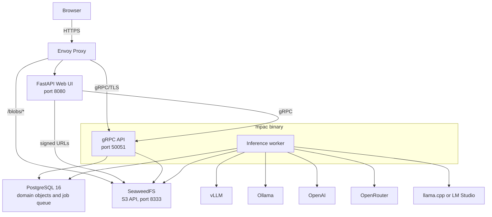
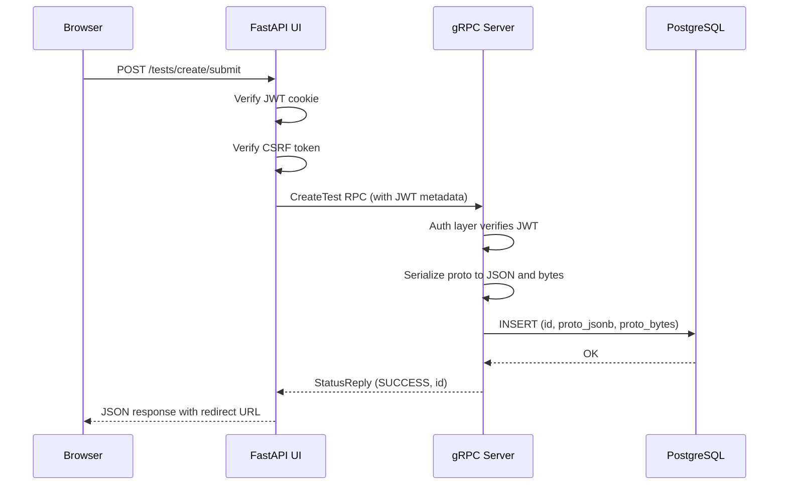
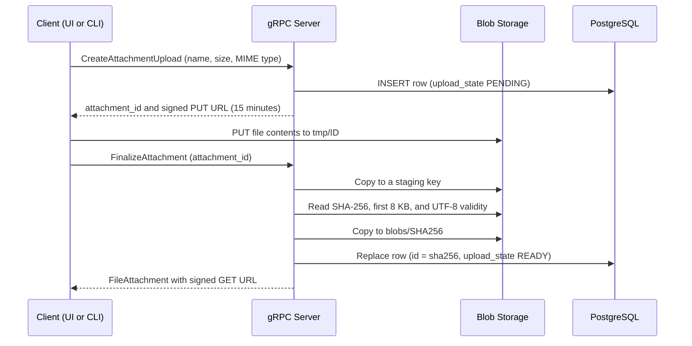
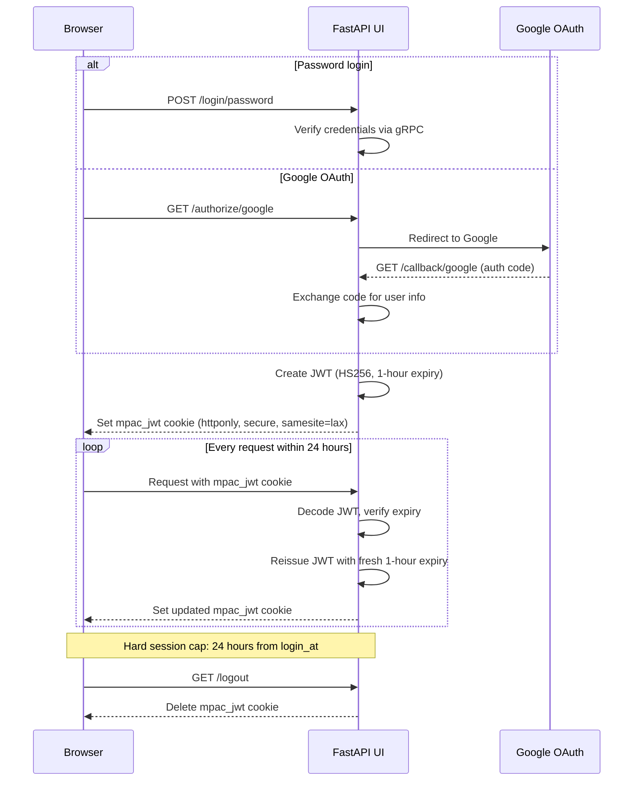
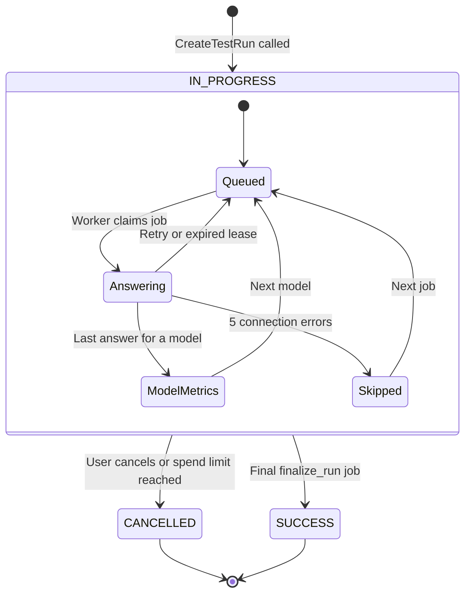
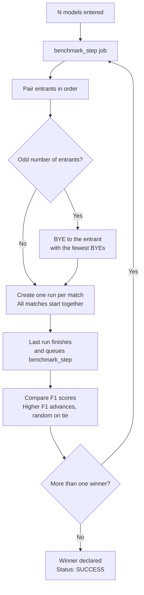
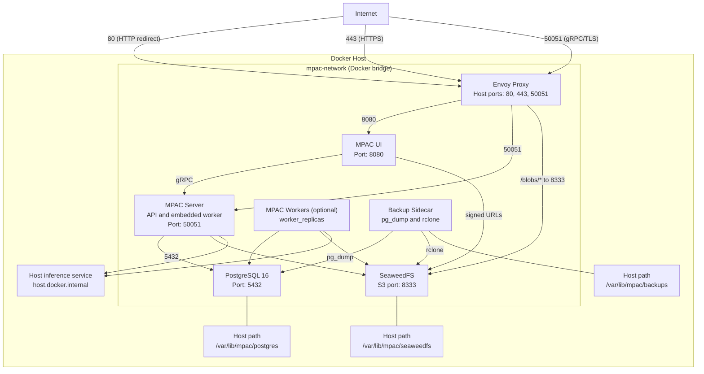
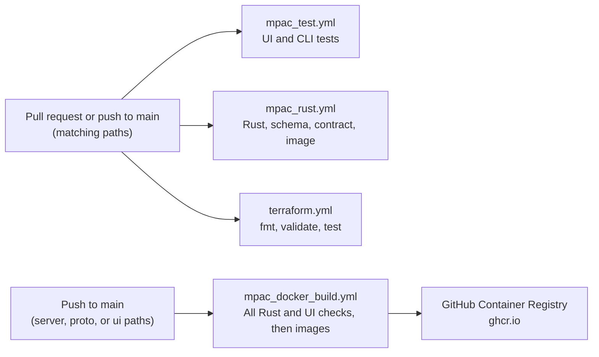

# MPAC Technical Guide

## Table of Contents

- [1 Overview](#1-overview)
  - [1.1 What MPAC Does](#11-what-mpac-does)
  - [1.2 System Components](#12-system-components)
  - [1.3 Key Terms](#13-key-terms)
- [2 Architecture](#2-architecture)
  - [2.1 Component Diagram](#21-component-diagram)
  - [2.2 gRPC Backend Server](#22-grpc-backend-server)
  - [2.3 Web UI](#23-web-ui)
  - [2.4 Database Schema](#24-database-schema)
  - [2.5 Data Flow](#25-data-flow)
  - [2.6 Job Queue and Workers](#26-job-queue-and-workers)
  - [2.7 Attachment Storage](#27-attachment-storage)
- [3 Authentication and Access Control](#3-authentication-and-access-control)
  - [3.1 Authentication Methods](#31-authentication-methods)
  - [3.2 JWT Session Lifecycle](#32-jwt-session-lifecycle)
  - [3.3 CSRF Protection](#33-csrf-protection)
  - [3.4 Visibility Levels](#34-visibility-levels)
  - [3.5 User Roles](#35-user-roles)
- [4 Tests](#4-tests)
  - [4.1 Test Types: Evaluation and Survey](#41-test-types-evaluation-and-survey)
  - [4.2 Create a Test](#42-create-a-test)
  - [4.3 Edit a Test](#43-edit-a-test)
  - [4.4 Set Test Visibility](#44-set-test-visibility)
  - [4.5 Export a Test](#45-export-a-test)
  - [4.6 Import a Test from a ZIP Archive](#46-import-a-test-from-a-zip-archive)
  - [4.7 Delete a Test](#47-delete-a-test)
- [5 Runs](#5-runs)
  - [5.1 What a Run Does](#51-what-a-run-does)
  - [5.2 Configure a Run](#52-configure-a-run)
  - [5.3 Run Lifecycle](#53-run-lifecycle)
  - [5.4 Monitor a Run](#54-monitor-a-run)
  - [5.5 Cancel a Run](#55-cancel-a-run)
  - [5.6 View Run Results](#56-view-run-results)
  - [5.7 Export a PDF Report](#57-export-a-pdf-report)
  - [5.8 Delete a Run](#58-delete-a-run)
  - [5.9 Run Recovery](#59-run-recovery)
- [6 Benchmarks](#6-benchmarks)
  - [6.1 Tournament Format](#61-tournament-format)
  - [6.2 Create a Benchmark](#62-create-a-benchmark)
  - [6.3 Benchmark Lifecycle](#63-benchmark-lifecycle)
  - [6.4 View the Bracket](#64-view-the-bracket)
  - [6.5 Cancel a Benchmark](#65-cancel-a-benchmark)
  - [6.6 Benchmark Recovery](#66-benchmark-recovery)
  - [6.7 Delete a Benchmark](#67-delete-a-benchmark)
- [7 Models and Backends](#7-models-and-backends)
  - [7.1 Model Catalog](#71-model-catalog)
  - [7.2 Backend Types](#72-backend-types)
  - [7.3 Local and Remote Backends](#73-local-and-remote-backends)
  - [7.4 Backend Concurrency](#74-backend-concurrency)
  - [7.5 Register, Enable, Disable, or Delete a Backend (ADMIN)](#75-register-enable-disable-or-delete-a-backend-admin)
  - [7.6 Provider Key Security](#76-provider-key-security)
- [8 Metrics and Analytics](#8-metrics-and-analytics)
  - [8.1 Date Range and Filters](#81-date-range-and-filters)
  - [8.2 Leaderboard, Per-Test Breakdown, Daily Charts](#82-leaderboard-per-test-breakdown-daily-charts)
  - [8.3 DuckDB Analytics Engine](#83-duckdb-analytics-engine)
- [9 User Settings](#9-user-settings)
  - [9.1 Profile and Spend](#91-profile-and-spend)
  - [9.2 Mint an API Key](#92-mint-an-api-key)
- [10 Administration (ADMIN)](#10-administration-admin)
  - [10.1 First-Time Admin Onboarding](#101-first-time-admin-onboarding)
  - [10.2 Manage Users](#102-manage-users)
  - [10.3 Manage Backends](#103-manage-backends)
  - [10.4 Rate Limiting](#104-rate-limiting)
- [11 Deployment: On-Premises Docker (ADMIN)](#11-deployment-on-premises-docker-admin)
  - [11.1 Prerequisites](#111-prerequisites)
  - [11.2 Deployment Topology](#112-deployment-topology)
  - [11.3 Terraform Variables](#113-terraform-variables)
  - [11.4 Deploy Procedure](#114-deploy-procedure)
  - [11.5 Envoy Proxy Configuration](#115-envoy-proxy-configuration)
  - [11.6 Backups and Restore](#116-backups-and-restore)
  - [11.7 Upgrade Procedure](#117-upgrade-procedure)
  - [11.8 Attachment Storage Operations](#118-attachment-storage-operations)
  - [11.9 Worker Modes](#119-worker-modes)
  - [11.10 Master Key Operations](#1110-master-key-operations)
- [12 CI/CD Pipeline (ADMIN)](#12-cicd-pipeline-admin)
  - [12.1 Pipeline Overview](#121-pipeline-overview)
  - [12.2 Unit and Integration Tests](#122-unit-and-integration-tests)
  - [12.3 Image Build and Push](#123-image-build-and-push)
  - [12.4 Local Development](#124-local-development)
- [13 gRPC API Reference](#13-grpc-api-reference)
  - [13.1 RPC Table](#131-rpc-table)
  - [13.2 Key Message Types](#132-key-message-types)
  - [13.3 Authentication Headers and Error Codes](#133-authentication-headers-and-error-codes)
- [Appendix A: Environment Variables](#appendix-a-environment-variables)
- [Appendix B: Terraform Variables](#appendix-b-terraform-variables)
- [Appendix C: Protobuf Enums](#appendix-c-protobuf-enums)
  - [BackendType](#backendtype)
  - [TestType](#testtype)
  - [FileModality](#filemodality)
  - [ResponseCode](#responsecode)
  - [UserRole](#userrole)
  - [Visibility Options](#visibility-options)
  - [Answer Status](#answer-status)
  - [UploadState](#uploadstate)

---

## 1 Overview

### 1.1 What MPAC Does

MPAC (Multi-Provider Agent Consensus) is a platform for AI model evaluation. It runs the same questions against multiple language models and measures their accuracy.

MPAC supports two test types:

- **Evaluation tests** have ground-truth answers. The system scores each model on precision, recall, and F1.
- **Survey tests** have no ground truth. The system records model responses for blind classification.

MPAC also runs benchmarks. A benchmark is a single-elimination tournament that compares models head-to-head. The model with the highest F1 score in each match advances.

### 1.2 System Components

MPAC consists of six parts:

- **gRPC backend server** is the `mpac` Rust binary. It serves the API and stores all domain data.
- **Inference worker** runs queued jobs and sends test items to AI models. It runs inside the server process by default, or in separate containers.
- **Web UI** is a FastAPI application with server-rendered HTML pages.
- **PostgreSQL database** persists all domain objects as protobuf messages. It also holds the job queue.
- **SeaweedFS** stores attachment file contents through an S3-compatible API.
- **Inference backends** are external model servers (vLLM, Ollama, LM Studio, OpenAI, OpenRouter, or llama.cpp).

MPAC deploys on-premises as six Docker containers on a single host behind an Envoy proxy. See [Section 11](#11-deployment-on-premises-docker-admin) for this deployment.

Terraform configurations for Google Cloud and AWS also exist. They provision object storage and a KMS master key for provider keys. These configurations pass offline tests only. They have not been deployed with the Rust server. See [Deploying MPAC](../terraform/DEPLOYMENT.md).

### 1.3 Key Terms

| Term | Definition |
|------|-----------|
| Test | A named collection of items with metadata and visibility settings |
| Item | A single question with choices and an optional attachment |
| Run | One execution of a test against one or more models |
| Benchmark | A single-elimination tournament that compares models by F1 score |
| Backend | A server that hosts AI models (for example, vLLM or OpenRouter) |
| Model | A specific AI model served by a backend |
| Attachment | A file (audio, image, video, or text) linked to a test item |
| Blob storage | Object storage that holds attachment file contents |
| Job | One unit of queued work, stored as a row in the `jobs` table |
| Worker | A process loop that claims and runs jobs |
| Lease | A time-limited claim on a job by one worker |
| Visibility | An access-control setting that limits who can view an object |
| F1 Score | A metric that combines precision and recall into one value |
| Precision | The fraction of positive predictions that are correct |
| Recall | The fraction of actual positives that the model found |
| Owner | The user who created an object |

---

## 2 Architecture

### 2.1 Component Diagram



The API and the worker share one process by default. You can also operate workers in separate containers. See [11.9 Worker Modes](#119-worker-modes).

### 2.2 gRPC Backend Server

The gRPC server is the `mpac` binary, written in Rust. The binary has these subcommands:

| Subcommand | Purpose |
|------------|---------|
| `serve` | Starts the API and an embedded worker. This is the image entrypoint. |
| `worker` | Starts a worker only. It still serves gRPC health. |
| `migrate` | Applies pending schema migrations, then exits. |
| `rotate-secret-key` | Rewraps provider keys under a new master key. |
| `onboard` | Creates the first admin, then exits. |

The `MPAC_ROLES` variable selects `api`, `worker`, or both. The default is `api,worker`.

The server exposes 49 RPCs across nine domains:

- Users
- Tests
- Test Items
- Runs
- Answers
- Attachments
- Backends
- Models
- Benchmarks

The server starts on port `50051` and connects to PostgreSQL. At startup, it applies pending schema migrations and creates the first admin if none exists. An auth layer authenticates every request except `LoginUser`, gRPC health, and gRPC reflection. Reflection is off by default.

Each domain has one module in `server/mpac_api/src/`. The API does not run inference. It writes jobs to the queue, and workers do the work. See [2.6 Job Queue and Workers](#26-job-queue-and-workers).

The maximum message size is 8 MiB when blob storage is active and 50 MiB when it is not. Attachment contents do not pass through gRPC when blob storage is active. Set `MPAC_MAX_MESSAGE_SIZE` to change the limit.

After `SIGTERM`, the server stops new work and drains active requests for up to 25 seconds.

### 2.3 Web UI

The web UI is a FastAPI application that renders HTML with Jinja2 templates. It communicates with the gRPC server through a persistent stub.

The UI serves these pages:

- **Dashboard** shows recent tests, recent runs, and a scatter chart of precision and recall values.
- **Tests** lists all tests and provides a spreadsheet editor for creation and editing.
- **Runs** shows run configuration, live status, and detailed results.
- **Models** displays a filterable catalog of all available models.
- **Benchmarks** shows tournament brackets and match history.
- **Metrics** renders aggregate analytics with DuckDB.
- **Settings** shows the user profile, spend totals, and API key management.
- **Admin** provides user and backend management (admin only).
- **Help** renders interactive protobuf API documentation.

The UI uses Tailwind CSS with a gold accent color (`#cca139`). A dark mode toggle persists in the browser.

The UI is a Python application. It imports the generated gRPC stubs and uses `ui/blobs.py` for attachment transfers. See [2.7 Attachment Storage](#27-attachment-storage).

The other Python parts are the CLI client `cli/mpac_cli.py` and the test tools. The backend does not use Python.

### 2.4 Database Schema

The server stores every domain object in a table with four columns:

| Column | Type | Purpose |
|--------|------|---------|
| `id` | `VARCHAR PRIMARY KEY` | Unique identifier |
| `proto_jsonb` | `JSONB` | Protobuf message as JSON (for queries) |
| `proto_bytes` | `BYTEA` | Raw protobuf bytes (for deserialization) |
| `created_at` | `TIMESTAMPTZ` | Row creation time |

The `tests` table has an extra `item_count INTEGER` column.

A separate `user_tpm_windows` table tracks per-user token consumption for rate limiting:

| Column | Type | Purpose |
|--------|------|---------|
| `user_id` | `TEXT` | User identifier |
| `window_minute` | `BIGINT` | Unix minute boundary |
| `tokens_used` | `BIGINT` | Tokens consumed in this window |

Domain tables: `attachments`, `backends`, `benchmarks`, `test_items`, `test_runs`, `test_run_answers`, `tests`, `users`.

The job queue and attachment cleanup use these tables:

| Table | Purpose |
|-------|---------|
| `jobs` | The job queue: kind, payload, status, attempts, lease, backend, and model |
| `run_counters` | The number of answer jobs that remain for each run |
| `benchmark_runs` | The pairs, BYEs, and run IDs for each benchmark round |
| `blob_cleanup` | Object keys that wait for deletion from blob storage |
| `backend_secrets` | Encrypted provider keys, one row per backend |
| `secret_audit` | An append-only record of provider key changes and decryptions |

The schema is in `server/mpac_db/migrations/`. Migrations are numbered and forward-only. The server applies them at startup unless you set `--skip_migrate`.

### 2.5 Data Flow

This diagram shows the flow for a typical create operation from the browser to the database.



### 2.6 Job Queue and Workers

MPAC does background work through a job queue in PostgreSQL. A job is one row in the `jobs` table. Workers claim jobs from any number of processes.

| Job Kind | Work |
|----------|------|
| `answer_item` | Sends one test item to one model and stores the answer |
| `finalize_run` | Publishes the metrics of one model, or finishes the complete run |
| `benchmark_step` | Starts the next bracket round, or finishes the benchmark |

**Claim rules.** Each claim holds a PostgreSQL advisory lock, so these rules apply across all workers:

- Jobs for one backend start in queue order, up to the concurrency limit of that backend.
- An `is_local` backend runs one model at a time. The next model starts after all active requests for the current model finish.
- A remote backend can run several models at the same time.
- Free worker slots go first to the backend with the fewest jobs in flight. A backlog on one backend cannot block another backend.
- `finalize_run` jobs start before other jobs.

**Signals.** Workers listen on the `mpac_jobs`, `mpac_cancel`, and `mpac_backend_changed` channels with PostgreSQL `LISTEN`/`NOTIFY`. Workers also poll every 5 seconds. A lost signal only delays work.

**Leases.** A claim gives the worker a 60-second lease. The worker renews the lease every 20 seconds. If a worker stops, its lease expires. Each worker looks for expired leases every 15 seconds and returns those jobs to the queue.

**Commits.** A worker writes its result and the job completion in one transaction. The transaction first makes sure that the worker still holds the lease. If the worker lost its lease, the system discards the result.

**Failures.** A job has three attempts. A failed attempt returns the job to the queue after 2 seconds, then after 4 seconds. A job can also fail permanently if retry cannot help. A permanent failure still counts as finished for the run, so the run can complete.

An inference error is not a job failure. The worker stores the error on the answer, and the job completes. See [Answer Status](#answer-status).

**Shutdown.** After `SIGTERM`, a worker stops claiming jobs and gives active jobs 25 seconds to finish. It then releases the remaining leases. A released job does not lose an attempt.

**Maintenance.** Every hour, each worker deletes finished jobs older than 7 days. It also removes attachment uploads that stayed pending for 24 hours.

### 2.7 Attachment Storage

MPAC stores attachment file contents in blob storage and attachment metadata in the `attachments` table. Set `MPAC_BLOB_URL` to `s3://bucket` or `gs://bucket`. The on-premises deployment uses SeaweedFS with the bucket `blobs`.

If `MPAC_BLOB_URL` is empty, the server stores file contents inline in the database row. The on-premises deployment always sets this variable.



The server inspects a private copy, not the upload object. An uploader cannot change the contents after inspection.

| Object Key | Contents |
|------------|----------|
| `tmp/<id>` | An upload that is not finalized |
| `staging/<id>` | A private copy during inspection |
| `blobs/<sha256>` | Permanent contents, named by their SHA-256 hash |

**Rejected uploads.** If the type is not supported or the file is too large, the server removes the pending row and returns `INVALID_ARGUMENT`. Supported types are audio, image, video, and text.

**Duplicate content.** Equal contents have the same attachment ID. If you can view the existing attachment and its visibility is equal, the server returns the existing attachment. If you cannot view it, the server returns `PERMISSION_DENIED`. If the visibility is different, the server returns `ALREADY_EXISTS`.

**Reads.** `GetAttachment` returns a signed GET URL in `uri`, valid for 1 hour. The database stores only the object key. `ListAttachments` and `BatchGetAttachments` with `metadata_only` return no URL. If the server cannot sign a URL, it returns an error. It does not return an empty file.

**Browser uploads.** The test editor keeps each selected file on disk in the browser until you save. It then sends each file as the body of a `POST /attachments/upload` request. The UI streams the body to blob storage and does not hold the file in memory. The editor shows the progress of each file.

**Downloads.** The UI streams `/attachments/{id}/file` and forwards `Range` requests, so a browser can seek in large video files. ZIP exports use a temporary file on disk above 64 MiB.

**Database size.** With blob storage, an attachment row holds only metadata. The file size does not change the row size, so large files do not add TOAST data or database load. Deployments without blob storage keep file bytes in the database.

**Inference.** A worker downloads the contents through a 256 MiB in-memory cache. The worker then sends the contents to the backend inline as base64. Local backends cannot reach signed URLs, so backends do not receive URLs. Each worker limits the memory for active attachments to about 1 GiB. Jobs with attachments wait when this budget is full, and jobs without attachments do not wait.

**Deletion.** A delete writes the object key to `blob_cleanup` in the same transaction as the row delete. A cleanup step then deletes each object that no attachment references. If an object delete fails, the key stays in the table for a later retry.

**Size limits:**

| Path | Limit | Set By |
|------|-------|--------|
| Browser test editor | 2 GiB per file | `MPAC_MAX_ATTACHMENT_SIZE` |
| `CreateAttachmentUpload` | 2 GiB per file | `MPAC_MAX_ATTACHMENT_SIZE` |
| ZIP import through the UI | 100 MB upload, 500 MB after decompression | The UI |
| Browser test editor, no blob storage | 256 MiB per file | The UI |
| Browser test editor and ZIP import on Google Cloud | 32 MB per request | The Cloud Run HTTP/1 request limit |
| Inference with a blob-stored attachment | 64 MiB per attachment | The worker |
| Inline `CreateAttachment`, blob storage active | 8 MiB | The server |
| Inline `CreateAttachment`, no blob storage | The smaller of 100 MiB and the message size limit | The server |

If an attachment is larger than 64 MiB, the worker does not send it to a model. The worker stores a `BAD_REQUEST` answer for that item, and the run continues. The editor shows a warning when you select such a file.

---

## 3 Authentication and Access Control

### 3.1 Authentication Methods

MPAC supports three authentication methods.

**Password login.** Users enter their email and password on the `/login/password` page. The server verifies the password with a scrypt hash. The server uses a constant-time comparison against a dummy hash for unknown users. This prevents timing attacks that reveal valid accounts.

**Google OAuth (optional).** Users click "Login with Google" on the login page. The button appears only when the UI has a Google OAuth client configured (`GOOGLE_OAUTH_CLIENT_ID` and `GOOGLE_OAUTH_CLIENT_SECRET`). See [Google sign-in](../terraform/DEPLOYMENT.md#google-sign-in-optional) for setup. The system redirects to Google with the OpenID Connect scope. On callback, the system verifies that the user exists in MPAC and updates their profile (name, avatar, organization domain). Google sign-in does not create accounts. An admin must invite the user first.

**API key.** gRPC clients pass an `x-api-key` header. The server hashes the key with SHA-256 and looks up the hash in the database. Results are cached for 60 seconds.

### 3.2 JWT Session Lifecycle



The JWT uses HS256 with the `MPAC_JWT_SECRET`. The token contains:

- `sub`: the user email
- `name`: the display name
- `avatar_url`: the profile picture URL
- `is_admin`: whether the user has the ADMIN role
- `org_domain`: the organization domain from OAuth
- `login_at`: the original login timestamp
- `exp`: the expiry time (1 hour from issuance)

The sliding-window middleware reissues the JWT on every request. The original `login_at` value persists. After 24 hours from the original login, the system redirects to the login page.

If the JWT is absent, expired, or invalid, the system redirects to `/login?next=<current_path>`.

### 3.3 CSRF Protection

The CSRF middleware protects all POST, PUT, DELETE, and PATCH requests. Two paths are exempt: `/login/` and `/callback/` (for the OAuth flow).

The system generates a 32-byte random token per session. The token is stored in the server-side session and rendered as a `<meta>` tag in the page HTML. A global `fetch` wrapper in the browser attaches the `X-CSRF-Token` header to all mutating requests. The server validates the token with a constant-time comparison.

### 3.4 Visibility Levels

Every test and attachment has a visibility setting. The visibility setting controls who can view the object.

| Level | Enum Value | Who Can View |
|-------|-----------|-------------|
| Unset | `VISIBILITY_UNSET` (0) | All authenticated users |
| Owner Only | `VISIBILITY_OWNER_ONLY` (1) | The owner and admins |
| Org Only | `VISIBILITY_ORG_ONLY` (2) | All authenticated users |
| Specified Users | `VISIBILITY_SPECIFIED_USERS` (3) | Named users, the owner, and admins |
| Public | `VISIBILITY_PUBLIC` (4) | All authenticated users |
| Admin | `VISIBILITY_ADMIN` (5) | Admins only |

Admins bypass all visibility filters. The gRPC server applies these filters with `visibility_clause` in `server/mpac_db/src/crud.rs` on every read operation.

Runs and answers inherit visibility from their parent test. If a test is deleted but the run still exists, the run owner can still view their own run.

### 3.5 User Roles

MPAC defines two active roles:

- **NORMAL** (value 1): Standard user. Can create tests, start runs, view results, and manage their own objects.
- **ADMIN** (value 2): Full access. Can manage all users, all backends, and all objects regardless of visibility.

The `NO_ROLE` value (0) is the unassigned default. Users with `NO_ROLE` can still authenticate but have the same access as `NORMAL` users.

Non-admin users who attempt to access the `/admin` page receive a 404 response. The system does not reveal that the admin page exists.

---

## 4 Tests

### 4.1 Test Types: Evaluation and Survey

**Evaluation tests** (`EVALUATION`, type 1) have ground-truth answers. Each item has an `answer` field and an `is_relevant` flag. The system scores model responses on precision, recall, and F1.

**Survey tests** (`SURVEY`, type 2) have no correct answers. The system records model responses for classification analysis. Survey tests do not generate accuracy metrics. Only evaluation tests are available for benchmarks.

### 4.2 Create a Test

1. Open the **Tests** page from the navigation drawer.
2. Click **Create Test**.
3. Enter a name for the test.
4. Select the test type: Evaluation or Survey.
5. Enter an optional description, provider, and labels.

**Add items to the test:**

1. Type a question in the **Question** column.
2. Enter choices in the **Choices** column, separated by semicolons.
3. For evaluation tests, enter the correct answer in the **Answer** column.
4. For evaluation tests, set the **Positive** checkbox if the item is a relevant or positive case.

**Spreadsheet editor features:**

- Press **Tab** or **Enter** to move to the next cell.
- Press **Ctrl+D** to fill the current cell value down to all selected cells.
- Paste tab-delimited data from a spreadsheet. The editor maps columns automatically.
- The editor appends a new row when you type in the last row.
- Click the duplicate icon to copy a row. Click the delete icon to remove a row.

**Attach files to items:**

1. Click the attachment cell for the target row.
2. Select a file or drag and drop a file onto the cell.
3. The editor shows an inline preview for images. Click the preview to open a lightbox.
4. Supported modalities: Audio, Image, Video, and Text.

Do not attach files larger than 2 GiB. The editor rejects files that exceed this limit. If an attachment is larger than 64 MiB, a run cannot send it to a model. See [2.7 Attachment Storage](#27-attachment-storage).

6. Click **Save** to submit the test.

### 4.3 Edit a Test

Only the test owner or an admin can edit a test.

1. Open the test detail page.
2. Click **Edit**.
3. Modify the test name, description, items, or attachments.
4. Click **Save** to submit the changes.

### 4.4 Set Test Visibility

1. Open the test detail page.
2. Click **Visibility** or the visibility settings control.
3. Select a visibility level from the list.
4. For "Specified Users", enter the email addresses of the allowed users.
5. Submit the form to save.

### 4.5 Export a Test

The system supports three export formats:

- **CSV**: A comma-separated file with one row per item.
- **JSON**: A JSON file with the test metadata and all items.
- **ZIP archive**: A ZIP file with `manifest.json` and an `attachments/` directory.

To export a test:

1. Open the test detail page.
2. Click the download button or select the format from the dropdown.
3. The browser downloads the file.

### 4.6 Import a Test from a ZIP Archive

The ZIP archive must contain a `manifest.json` file at the root. The manifest holds the test metadata and items. An `attachments/` directory in the archive holds the attachment files.

1. Open the **Tests** page.
2. Click **Import**.
3. Select the ZIP file.
4. The system creates the test and all items with their attachments.

The UI accepts ZIP files up to 100 MB, or 500 MB after decompression, with up to 100,000 items. The system stores each attachment in blob storage.

### 4.7 Delete a Test

Only the test owner or an admin can delete a test. The system deletes all items and exclusive attachments in the same transaction. A cleanup step then removes their file contents from blob storage.

Do not delete a test that has active runs. Cancel all runs first.

1. Open the test detail page.
2. Click **Delete**.
3. Confirm the deletion.

---

## 5 Runs

### 5.1 What a Run Does

A run sends test items to one or more AI models and records their responses. For evaluation tests, the system compares each response to the ground-truth answer. The system then calculates per-model metrics.

Each model receives the same set of randomly sampled items. The system uses a zero-shot, pass-at-one strategy: each model gets one attempt per item with no examples.

### 5.2 Configure a Run

1. Open the **Runs** page from the navigation drawer.
2. Click **Create Run**.
3. Select a test from the dropdown.
4. Select one or more models. Models are grouped by provider and backend.
5. Set the **sample size** (the number of items to include from the test).
6. Enable **reasoning** if you want the models to explain their answers. This costs more tokens.

The configuration page shows your current spend (daily and monthly in USD) and your limits. It also shows the cost per model to help you estimate the total cost.

Do not exceed your daily or monthly spend limit. The system cancels runs that exceed the limit.

### 5.3 Run Lifecycle



The run lifecycle operates as follows:

1. The server makes sure that the run is within the spend limits and the projected cost limits.
2. In one transaction, the server creates the run with status `IN_PROGRESS`, samples items, and writes the jobs.
3. The server writes one `answer_item` job for each model and item, grouped by model.
4. Workers claim the jobs under the rules in [2.6 Job Queue and Workers](#26-job-queue-and-workers).
5. For each job, the worker loads the attachment, sends the request, and stores the answer.
6. When a model has all its answers, a `finalize_run` job publishes the metrics of that model.
7. When no answer jobs remain, a final `finalize_run` job calculates all metrics and the total cost. It then writes status `SUCCESS`.

The system enforces a circuit breaker. If the last five answers from a model in a run are all connection errors, the model is skipped. Workers then write `SKIPPED` answers for its remaining items.

A run ends with `SUCCESS` even if some answers contain errors. The metrics include these answers in `refusal_error_rate`. Workers do not write status `ERROR` to a run.

### 5.4 Monitor a Run

The run status page polls the server every few seconds. The page shows:

- The current status (IN_PROGRESS, SUCCESS, ERROR, or CANCELLED)
- The number of completed answers per model
- A progress indicator

The page redirects to the run details page on completion.

### 5.5 Cancel a Run

1. Open the run status page or the run details page.
2. Click **Cancel**.
3. The system writes status `CANCELLED` and cancels all queued and leased jobs for the run.
4. Workers receive a signal and stop the active requests of the run.
5. A final job calculates metrics from the answers that exist.

You can cancel a run through any API instance. The signal reaches all workers through PostgreSQL.

The API accepts only this change to a run. `UpdateTestRun` ignores other fields, and it does not change a finished run. `UpdateBenchmark` works the same way.

### 5.6 View Run Results

The run details page contains several sections.

**Run details card.** Shows the owner, test link, test type, timestamps, status, sample size, total cost, and total token count. Status is color-coded:

- Green: `SUCCESS`
- Red: `ERROR`
- Blue: `IN_PROGRESS`
- Yellow: `CANCELLED`

**Results summary.** Shows models ranked by F1 score (evaluation) or by output tokens per second (survey). The top three models have gold, silver, and bronze styling.

**Answers spreadsheet.** A table with frozen left columns (row number, attachment, question, context, expected answer) and horizontally scrollable model answer columns. Cells are color-coded:

- Green: correct answer
- Red: incorrect answer

Filter buttons allow you to select specific models or filter by classification (TP, TN, FP, FN). Each answer cell can show the model reasoning and the raw response in a modal.

**Model cards.** Side-by-side metric cards for each model. Metrics include:

- Precision, Recall, F1
- Output tokens per second (p50)
- Latency p50 and p95
- Throughput (tokens per second)
- Total tokens and cost
- Error and refusal count

Star markers indicate the best value across all models.

**Leaderboard chart.** A horizontal bar chart that shows the F1 score for each model. Three quality threshold lines appear:

- Low: 70%
- OK: 80%
- High: 95%

The chart supports modality filtering (All, Text, Image, Audio, Video).

**Confusion matrix.** A per-model grid of TP, TN, FP, and FN counts. Cell colors scale with the count value.

**Timeline.** A timeline chart that shows the wall-clock start and duration for each model.

### 5.7 Export a PDF Report

The PDF report contains the same data as the run details page in a print-ready format.

1. Open the run details page.
2. Click the **Download** dropdown.
3. Select **PDF Report**.

The report uses A4 portrait format with 15 mm side margins. It includes:

- A cover page with run metadata
- A methodology section
- Core concept definitions and metric definitions
- An executive summary with a winner banner
- A leaderboard chart (rendered as SVG)
- A timeline chart (rendered as SVG)
- A performance-by-modality table
- Confusion matrices
- Model cards
- The full answers table with color-coded cells
- An error analysis section (up to 25 false positives and 25 false negatives per model)

Images in the report are embedded as base64 data URIs. The system resizes images to a maximum width of 400 pixels and converts them to JPEG at 80% quality.

### 5.8 Delete a Run

Only the run owner or an admin can delete a run. The system cancels the jobs of the run, then deletes all its answers in one transaction.

1. Open the run details page.
2. Click **Delete**.
3. Confirm the deletion.

### 5.9 Run Recovery

The state of a run is in the job queue, so runs continue after a restart.

- If a worker restarts, workers claim the jobs that remain in the queue.
- If a worker stops without warning, its leases expire within 60 seconds. Another worker then claims those jobs.
- Stored answers stay in the database. The system repeats only the jobs that did not commit.
- An expired lease uses one of the three attempts of a job. A normal shutdown does not.

---

## 6 Benchmarks

### 6.1 Tournament Format

A benchmark is a single-elimination tournament. Each match pits two models against each other on the same test. The model with the higher F1 score wins and advances to the next round. Ties are broken randomly.

The system shuffles the entrants before round 1. Later rounds keep the order of the winners.

If an odd number of models enter a round, one model receives a BYE and advances without a match. The BYE goes to the last entrant with the fewest earlier BYEs. A model receives a second BYE only if all entrants in that round already had one.

Round names come from the distance to the last round:

- Last round: "Final"
- One round before: "Semifinals"
- Two rounds before: "Quarterfinals"
- Earlier rounds: "First Round" for round 1, then "Round 2", "Round 3", and so on

Only evaluation tests (type `EVALUATION`) are valid for benchmarks.

### 6.2 Create a Benchmark

1. Open the **Benchmarks** page from the navigation drawer.
2. Click **Create Benchmark**.
3. Select an evaluation test.
4. Select two or more models.
5. Set the sample size per match.
6. Enable reasoning if desired.
7. Click **Submit**.

The system verifies your spend limits before the benchmark starts. The cost projection formula accounts for the tournament structure: each model plays approximately two matches in a single-elimination bracket.

### 6.3 Benchmark Lifecycle



Each match is a full test run with both models. All matches in a round start at the same time, and backend concurrency limits still apply. A round resolves when none of its runs has status `IN_PROGRESS`.

The match has no overall time limit. Each request has the timeout in [7.3 Local and Remote Backends](#73-local-and-remote-backends). If a model has no metrics for a match, its score is -1.

### 6.4 View the Bracket

The benchmark details page shows:

- The match history grouped by round
- The tournament bracket with winners highlighted
- Per-match confusion matrix data
- The overall winner

The system records each match when its run finishes. A BYE appears when its round starts. The status page shows all unfinished matches in the current round as active, and it polls every 3 seconds.

### 6.5 Cancel a Benchmark

1. Open the benchmark status page.
2. Click **Cancel Benchmark**.
3. Confirm the cancellation.

The system cancels all active match runs and their jobs.

### 6.6 Benchmark Recovery

The bracket state is in the `benchmarks` and `benchmark_runs` tables. Each step runs in one transaction with an advisory lock on the benchmark ID. After a restart, workers continue the match runs in the queue. The last run in a round then starts the next step.

### 6.7 Delete a Benchmark

1. Open the benchmark details page.
2. Click **Delete**.
3. Confirm the deletion.

---

## 7 Models and Backends

### 7.1 Model Catalog

Models are not stored in the MPAC database. The server queries each enabled backend at request time and merges the results into a unified catalog.

The Models page at `/models` displays all available models. The page provides client-side filtering by:

- Provider
- Family
- Quantization
- Modality (TEXT, VISION, AUDIO)
- License

Each model has the following properties:

| Property | Description |
|----------|-----------|
| `id` | The model identifier at the backend |
| `name` | The display name |
| `provider` | The model creator (for example, OpenAI or Meta) |
| `family` | The model family (for example, GPT-4 or Llama) |
| `format` | The weight format (for example, GGUF) |
| `parameters` | The parameter count |
| `parameters_label` | A human-readable parameter label (for example, "70B") |
| `quantization` | The quantization strategy (for example, Q4_K_M or AWQ) |
| `temperature` | The sampling temperature (0 to 1) |
| `backend_id` | The serving backend identifier |

**Pricing fields** (per 1,000 tokens):

| Field | Description |
|-------|-----------|
| `input_token_cost` | Cost per 1K input tokens |
| `output_token_cost` | Cost per 1K output tokens |
| `image_token_cost` | Cost per 1K image tokens |
| `audio_token_cost` | Cost per 1K audio tokens |

**Capability fields:**

| Field | Description |
|-------|-----------|
| `modality` | Supported input types (for example, "text" or "text+image") |
| `context_window_length` | Maximum context length in tokens |
| `tokenizer` | The tokenizer name |
| `instruct` | The instruction format type |

### 7.2 Backend Types

| Type | Enum Value | Description |
|------|-----------|-----------|
| vLLM | `VLLM` (1) | Open-source model serving with OpenAI-compatible API |
| Ollama | `OLLAMA` (2) | Local model runner for GGUF and safetensor weights |
| OpenAI | `OPENAI` (3) | OpenAI API (GPT models) |
| OpenRouter | `OPENROUTER` (4) | Multi-provider API aggregator |
| Debug Random | `DEBUG_RANDOM` (5) | Test backend that returns random answers |
| llama.cpp | `LLAMA_CPP` (6) | C++ inference engine for GGUF models |

The Debug Random backend generates 101 synthetic models: one "know_it_all" model (always correct) and 100 random models. This backend is useful for testing the platform without real inference costs.

### 7.3 Local and Remote Backends

MPAC classifies backends as local or remote. The classification determines timeout values and concurrency defaults.

| Setting | Local | Remote |
|---------|-------|--------|
| Request timeout | 600 seconds (10 minutes) | 120 seconds (2 minutes) |
| Default concurrency | 4 | 20 |
| Models in flight | One at a time | Any number |

Local backends include Ollama, LM Studio, llama.cpp, and self-hosted vLLM. Remote backends include OpenAI, OpenRouter, and cloud-hosted vLLM.

Set the `is_local` flag to `true` for self-hosted backends. This flag controls the timeout and concurrency behavior.

If a backend runs on the Docker host, use `host.docker.internal` in the base URL, for example `http://host.docker.internal:1234/v1`. The service must listen on an interface that Docker can reach.

### 7.4 Backend Concurrency

Two limits control concurrent requests:

- **Backend limit.** The `max_concurrency` value of a backend. If the value is 0, the system uses the default (4 for local, 20 for remote). The claim query enforces this limit in PostgreSQL, so it holds across all workers.
- **Worker limit.** The `MPAC_WORKER_CONCURRENCY` value limits the jobs that one worker runs at the same time. The default is 32.

Set the worker limit equal to or higher than the sum of your backend limits. A lower value caps your backends and leaves their slots empty.

A local backend runs one model at a time, because local model servers can stop active requests when they load another model. A run with several models on a local backend therefore takes longer than the same run on a remote backend.

Workers use one shared HTTP client with connection pooling. The client retries a failed request up to two times, with a delay of up to 8 seconds. It also obeys a `Retry-After` value of up to 60 seconds. The client retries an error inside a response stream up to two times.

When you update or delete a backend, the system sends a signal. Workers then clear their stored information about that backend, for example whether a model supports logprobs.

### 7.5 Register, Enable, Disable, or Delete a Backend (ADMIN)

All backend management operations require admin access.

**Register a new backend:**

1. Open the **Admin** page.
2. Select the **Backends** tab.
3. Click **Add Backend**.
4. Enter the backend name, type, base URL, and API key.
5. Set the `is_local` flag for self-hosted backends.
6. Set `max_concurrency` to override the default (0 uses the system default).
7. Click **Save**.

The system enables the backend by default. Non-admin users can view the backend only when it is enabled.

**Enable or disable a backend:**

1. Open the **Admin** page and select the **Backends** tab.
2. Click the toggle for the target backend.
3. A disabled backend does not appear in the model catalog for non-admin users.

**Delete a backend:**

1. Open the **Admin** page and select the **Backends** tab.
2. Click **Delete** for the target backend.
3. Confirm the deletion.

Do not delete a backend while runs are active against its models. The runs will fail with connection errors.

### 7.6 Provider Key Security

MPAC encrypts each provider API key before it reaches the database. The `backends` table, its JSON, and database dumps do not contain the key.

**Encryption.** Each key has its own random data key and uses AES-256-GCM. The ciphertext is bound to the backend ID, so a row cannot move to another backend. A master key outside the database wraps each data key.

**Use.** A provider request needs the plaintext key, so the worker must hold it in memory. A worker decrypts a key when it first needs it, then caches it for 5 minutes. A run with 1,000 answers therefore causes few decryptions. Each request reads the backend URL and the stored key in one query, then uses a cached key only if it matches that stored key. A change to a backend therefore takes effect at the next request in every process, with no signal. The `mpac_backend_changed` signal only removes old plaintext from memory earlier.

**Master key options.** Set `MPAC_SECRET_KEY_URL` to one of these values:

| Value | Master Key |
|-------|-----------|
| `file:///path/to/key` | A file with 32 random bytes, base64 encoded |
| `vault+https://host:8200/transit/mpac` | A Vault or OpenBao transit key. `VAULT_TOKEN` holds the token |
| `aws-kms:arn:aws:kms:region:account:key/id` | An AWS KMS key or alias ARN. MPAC uses `AWS_ACCESS_KEY_ID` and `AWS_SECRET_ACCESS_KEY`, or the ECS task role |
| `gcp-kms:projects/P/locations/L/keyRings/R/cryptoKeys/K` | A Google Cloud KMS key. MPAC uses the attached service account, or `GOOGLE_OAUTH_ACCESS_TOKEN` |

If `MPAC_SECRET_KEY_URL` is empty, the server rejects any new provider key with `FAILED_PRECONDITION`. Backends without a key still work.

**Audit.** The `secret_audit` table records each key create, update, delete, rewrap, and decryption, with the actor and key version. It records a decryption on a cache miss, not on every request. A decryption fails if the system cannot write its audit row. Admins read the trail with the `ListSecretAudit` RPC.

**Changing a host.** If you move a backend to a new host, the server requires the key again. This stops the stored key from going to a host that you did not intend.

**KMS availability.** With Vault or KMS, a decryption needs a network request. The worker makes one request for each cache miss, so a large run causes few requests. If the service is down, a cached key continues to work for up to 5 minutes. After that, requests that need the key fail until the service returns.

**Key failures.** If MPAC cannot load a stored key, it does not call the provider without the key. `ListModels` omits that backend and logs the error. If no models remain, it returns the error, and so does `GetModel` if it cannot find the model. `GetCredits` returns the error. The code is `UNAVAILABLE` if the key service failed, and `FAILED_PRECONDITION` if the master key is missing or wrong. A worker retries the job, and the normal job failure rules apply.

**Limits.** This design protects against leaks of the database, dumps, and SQL read access. It does not protect against root access on the server. Cached keys are in server memory. With a key file, the master key is also on that host. With Vault or KMS, the master key cannot leave the service, but the server can ask the service to decrypt. To limit the effect of a leak, set credit limits on your provider keys.

Client API keys (`x-api-key`) are a separate mechanism. The server stores only their SHA-256 hash.

---

## 8 Metrics and Analytics

### 8.1 Date Range and Filters

The Metrics page at `/metrics` shows aggregate performance data across all runs. Select a date range with the preset buttons:

- 7 days
- 30 days
- 90 days (default)
- 1 year
- Custom start and end dates

You can also filter by a specific test ID.

### 8.2 Leaderboard, Per-Test Breakdown, Daily Charts

The Metrics page contains three main sections.

**Median leaderboard.** A table of all models ranked by median F1 score within the date range. The table includes per-modality F1 breakdown (TEXT, IMAGE, AUDIO, VIDEO), refusal rate, latency p50 and p95, output tokens per second, and total responses.

**Per-test breakdown.** A separate table that shows metrics per test within the date range.

**Daily charts.** Line charts that show daily token consumption and cost per user.

The system caps the query at 10,000 runs. If the date range contains more runs, the page shows a truncation notice.

### 8.3 DuckDB Analytics Engine

The Metrics page uses DuckDB for in-process SQL analytics. The UI converts protobuf data to Pandas DataFrames and executes DuckDB queries against them. This approach avoids complex SQL queries against the PostgreSQL JSONB columns.

---

## 9 User Settings

### 9.1 Profile and Spend

The Settings page at `/settings` shows your profile:

- Avatar (from Google OAuth) or initials
- Display name
- Organization domain
- Role (NORMAL or ADMIN)
- Member since date

The page also shows your current spend:

- Daily spend in USD
- Monthly spend in USD
- Test count
- Run count

### 9.2 Mint an API Key

API keys allow gRPC clients to authenticate without OAuth. Each user can have one active API key.

1. Open the **Settings** page.
2. Click **Generate API Key**.
3. Copy the key. The key starts with `sk_live_` and contains 32 random bytes.

Do not close the page before you copy the key. The system stores only the SHA-256 hash. You cannot retrieve the raw key after you leave the page.

---

## 10 Administration (ADMIN)

All operations in this section require the ADMIN role.

### 10.1 First-Time Admin Onboarding

The server bootstraps the first admin user at startup. Set these environment variables or server flags:

| Environment Variable | Server Flag | Purpose |
|---------------------|------------|---------|
| `MPAC_ADMIN_ONBOARDING_ID` | `--admin_onboarding_id` | The admin email address |
| `MPAC_ADMIN_ONBOARDING_PASSWORD` | `--admin_onboarding_password` | The admin password |
| `MPAC_ADMIN_API_KEY` | `--admin_onboarding_api_key` | The raw API key |

Flags take priority over environment variables. If any admin exists, the system skips onboarding, so you can leave these values in place. If no admin exists and the user exists, the system promotes that user to ADMIN and replaces their password and API key.

You can also create the first admin with the `mpac onboard` subcommand.

After the first admin exists, you can create more users and promote them through the Admin page.

### 10.2 Manage Users

**Add a user:**

1. Open the **Admin** page.
2. Select the **Users** tab.
3. Click **Add User**.
4. Enter the email address and optional password.
5. Select the role (NORMAL or ADMIN).
6. Set rate limits (optional).
7. Click **Save**.

The system hashes the password with werkzeug. If you do not set a password, the user must use Google OAuth.

**Update a user:**

1. Open the **Admin** page and select the **Users** tab.
2. Click the edit button for the target user.
3. Modify the role, rate limits, or password.
4. Click **Save**.

The system preserves the existing password hash and API key hash when you send an update with empty credential fields. This prevents accidental credential wipes.

**Set rate limits:**

| Limit | Description | Unit |
|-------|-----------|------|
| `tokens_per_minute` | Maximum tokens per 60-second window | Tokens (0 = unlimited) |
| `daily_spend` | Maximum spend per UTC calendar day | USD cents (0 = unlimited) |
| `monthly_spend` | Maximum spend per UTC calendar month | USD cents (0 = unlimited) |

**Delete a user:**

1. Open the **Admin** page and select the **Users** tab.
2. Click **Delete** for the target user.
3. Confirm the deletion.

### 10.3 Manage Backends

See [7.5 Register, Enable, Disable, or Delete a Backend (ADMIN)](#75-register-enable-disable-or-delete-a-backend-admin) for backend management procedures.

**Check backend credits:**

For OpenRouter backends, you can view the remaining credit balance.

1. Open the **Admin** page and select the **Backends** tab.
2. Click the credits icon for the OpenRouter backend.
3. The system queries the OpenRouter `/api/v1/credits` endpoint and displays the total, used, and remaining credits.

### 10.4 Rate Limiting

MPAC enforces three rate-limit types.

**Tokens per minute (TPM).** The system tracks token consumption in 60-second windows. The `user_tpm_windows` table stores the count per user per minute boundary. The worker records tokens after each answer. Before it sends a request, the worker reads the count. If the user exceeded the limit, the worker returns the job to the queue until the next minute window. The job does not lose an attempt.

**Daily spend.** The system sums `total_cost_usd` from the `test_runs` table for the current UTC day. If the total reaches the limit (in USD cents), the system blocks new runs and cancels active runs.

**Monthly spend.** The same mechanism as daily spend, scoped to the current UTC month.

**Pre-flight cost projection.** Before a run starts, the system estimates the total cost:

```
projected_cost = sample_size * per_item_cost * num_models
```

For benchmarks, the formula accounts for the tournament structure:

```
projected_cost = (2 * (n - 1) / n) * num_items * sum_of_per_model_costs
```

If the projected cost exceeds the remaining daily or monthly budget, the system blocks the run with a `RESOURCE_EXHAUSTED` error.

**Mid-run enforcement.** After each answer, the worker adds the cost of the current run to the stored spend of the user. If the total reaches a limit, the system cancels the run. This calculation does not include unfinished costs of other active runs. The system writes `total_cost_usd` when the run finishes.

---

## 11 Deployment: On-Premises Docker (ADMIN)

### 11.1 Prerequisites

- Docker Engine
- Terraform (version 1.7 or later)
- Bazel, if you build the images locally
- Free host ports 80, 443, and 50051 (or other ports that you set)
- Host directories for PostgreSQL data, SeaweedFS data, and backups (not `/tmp`)
- An existing inference service (this deployment does not install one)

Terraform generates a self-signed TLS certificate by default. To use your own certificate, set `tls_cert_path` and `tls_key_path`.

### 11.2 Deployment Topology



The deployment has six long-running containers: `mpac-envoy`, `mpac-ui`, `mpac-server`, `mpac-postgres`, `mpac-postgres-backup`, and `mpac-seaweedfs`. If `worker_replicas` is above 0, it also has `mpac-worker-1`, `mpac-worker-2`, and so on.

Two short-lived containers run during `terraform apply` and then exit. `mpac-blob-init` creates the `blobs` bucket. `mpac-backup-tools-init` copies the `rclone` binary into a shared volume.

Only the Envoy proxy binds to host ports. The Docker network provides DNS aliases:

- `postgres` / `db`
- `server` / `mpac-server`
- `ui` / `mpac-ui`
- `envoy` / `proxy`
- `seaweedfs`

The server and worker containers map `host.docker.internal` to the host gateway. This allows them to reach host-side services (for example, Ollama on port 11434). Use `host.docker.internal` in backend URLs. Do not use `localhost`, because the mapping does not cover every loopback address.

### 11.3 Terraform Variables

| Variable | Default | Sensitive | Description |
|----------|---------|-----------|-------------|
| `project_name` | `"mpac"` | No | Resource naming prefix |
| `use_local_images` | `false` | No | Use loaded server and UI images, with no registry lookup |
| `postgres_version` | `"16"` | No | PostgreSQL version |
| `postgres_user` | `"postgres"` | No | Database username |
| `postgres_password` | (required) | Yes | Database password |
| `postgres_db` | `"mpac"` | No | Database name |
| `postgres_data_path` | `/var/lib/mpac/postgres` | No | Host path for data volume |
| `postgres_backup_path` | `/var/lib/mpac/backups` | No | Host path for backup files |
| `postgres_backup_retention_days` | `30` | No | Days to retain database dumps |
| `postgres_backup_schedule` | `"0 2 * * *"` | No | Not used. Kept for compatibility. See `backup_interval_seconds` |
| `backup_interval_seconds` | `86400` | No | Seconds between backups |
| `rclone_image` | `rclone/rclone:1.70.3` | No | Image that supplies the backup copy tool |
| `mpac_jwt_secret` | (required) | Yes | HS256 secret for JWT |
| `server_image` | `ghcr.io/pelidum/mpac_server:latest` | No | Server and worker container image |
| `server_port` | `50051` | No | Internal gRPC port |
| `server_host` | `"0.0.0.0"` | No | Server bind address |
| `server_db_pool_size` | `100` | No | Database connection pool size |
| `server_admin_onboarding_id` | `""` | No | First admin email |
| `server_admin_onboarding_password` | `""` | Yes | First admin password |
| `server_enable_reflection` | `false` | No | Expose the gRPC reflection API |
| `server_max_message_size_mb` | `8` | No | Maximum gRPC message size in MB |
| `max_attachment_size_mb` | `2048` | No | Maximum attachment upload size in MB |
| `seaweedfs_image` | `chrislusf/seaweedfs:4.50` | No | SeaweedFS container image |
| `blob_data_path` | `/var/lib/mpac/seaweedfs` | No | Host path for SeaweedFS data |
| `secret_key_path` | `""` | No | Host path to your provider key master key (empty generates one) |
| `secret_key_url` | `""` | No | External master key, for example a Vault transit URL |
| `secret_key_vault_token` | `""` | Yes | Token for the server in `secret_key_url` |
| `worker_replicas` | `0` | No | Separate worker containers (0 embeds the worker in the server) |
| `worker_concurrency` | `32` | No | Maximum concurrent jobs per worker |
| `ui_image` | `ghcr.io/pelidum/mpac_ui:latest` | No | UI container image |
| `ui_port` | `8080` | No | Internal UI port |
| `ui_debug` | `false` | No | Enable debug mode |
| `ui_grpc_insecure` | `true` | No | Use a plaintext gRPC channel from the UI to the server |
| `ui_system_user` | `system@mpac.internal` | No | Background task identity |
| `ui_trusted_proxies` | `"envoy,proxy"` | No | Trusted proxies for `X-Forwarded-For` |
| `google_oauth_client_id` | `""` | No | Google OAuth client ID (optional). Enables "Login with Google" |
| `google_oauth_client_secret` | `""` | Yes | Google OAuth client secret (optional) |
| `envoy_image` | `envoyproxy/envoy:v1.29-latest` | No | Envoy container image |
| `envoy_http_port` | `80` | No | External HTTP port |
| `envoy_https_port` | `443` | No | External HTTPS port |
| `envoy_grpc_port` | `50051` | No | External gRPC port |
| `envoy_bind_ip` | `"0.0.0.0"` | No | Envoy bind address |
| `envoy_config_path` | `""` | No | Host path to your own `envoy.yaml` (empty uses the generated file) |
| `tls_cert_path` | `""` | No | Host path to your TLS certificate (empty generates a certificate) |
| `tls_key_path` | `""` | Yes | Host path to your TLS private key |
| `tls_domain` | `"localhost"` | No | Public hostname, used in URLs and in the generated certificate |
| `tls_validity_days` | `825` | No | Validity of the generated certificate |

Do not set `postgres_data_path` or `blob_data_path` to a path under `/tmp`. The validation rules reject these paths to prevent data loss on reboot.

Terraform generates the S3 access keys for SeaweedFS. Protect the Terraform state, `terraform.tfvars`, and the `generated/` directory, because they contain secrets. After the first apply, run `chmod 600 terraform.tfvars terraform.tfstate`.

### 11.4 Deploy Procedure

Run these steps from the repository root.

1. Copy `terraform/on_prem/terraform.tfvars.example` to `terraform/on_prem/terraform.tfvars`.
2. Set `postgres_password`, `mpac_jwt_secret`, and the two `server_admin_onboarding_*` values.
3. If you build the images locally, load them into Docker:

   ```bash
   bazel run //server/mpac:mpac_image_load_amd64
   bazel run //ui:mpac_ui_image_load
   ```

4. If you build the images locally, also set these values in `terraform.tfvars`:

   ```hcl
   use_local_images = true
   server_image     = "ghcr.io/pelidum/mpac_server:latest-amd64"
   ```

5. Run `terraform -chdir=terraform/on_prem init`.
6. Run `terraform -chdir=terraform/on_prem plan` to review the changes.
7. Run `terraform -chdir=terraform/on_prem apply` to create all containers.
8. Run `docker ps` and make sure that the six long-running containers are active.
9. Run `terraform -chdir=terraform/on_prem output ui_url` and open that address.
10. Sign in with the onboarding admin credentials.
11. Register your inference backends. See [7.5 Register, Enable, Disable, or Delete a Backend (ADMIN)](#75-register-enable-disable-or-delete-a-backend-admin).

The server image also has an arm64 build: `mpac_image_load_arm64` and the `latest-arm64` tag. The UI image builds for `linux/amd64` only.

To test the deployed system, run the smoke check in the [on-premises README](../terraform/on_prem/README.md#local-end-to-end-quickstart).

For a longer test, run `bazel run //terraform/on_prem:soak`. This test uses a scripted provider. It covers a multi-model local run, key decryption, cancellation, a server kill, live benchmark updates, and a 2 GiB upload. Use a separate test deployment, because the test kills the server and leaves its records in the database. The test needs the smoke check options, plus `--server-container`, `--ui-container`, and `--network`.

### 11.5 Envoy Proxy Configuration

Terraform renders `generated/envoy.yaml` from `terraform/on_prem/envoy.yaml`. The file defines three listeners:

| Listener | Container Port | Host Port |
|----------|----------------|-----------|
| HTTP | 8080 | `envoy_http_port` (80) |
| HTTPS | 8443 | `envoy_https_port` (443) |
| gRPC TLS | 50051 | `envoy_grpc_port` (50051) |

**HTTP listener.** Redirects all traffic to HTTPS with a 301 response.

**HTTPS listener.** Terminates TLS with ALPN negotiation (HTTP/2 and HTTP/1.1). It has two routes:

- `/blobs/` goes to SeaweedFS at `seaweedfs:8333`. Envoy does not change the host, path, or query, because any change makes the URL signature invalid.
- All other requests go to the UI container at `ui:<ui_port>`. Envoy adds a `Content-Security-Policy: upgrade-insecure-requests` header to these responses.

The stream idle timeout is 86,400 seconds (24 hours). This long timeout supports long-running requests and large transfers.

**gRPC listener.** Terminates TLS with HTTP/2 only. Routes traffic to the gRPC server at `server:<server_port>`. Uses the same TLS certificate and key as the HTTPS listener.

The connections to the UI and the server use these TCP keepalive values:

- Keepalive time: 300 seconds
- Keepalive interval: 60 seconds
- Keepalive probes: 5

If you set `envoy_config_path` to your own file, keep the `/blobs/` route and the ports.

### 11.6 Backups and Restore

The backup sidecar makes one backup at startup, then one every `backup_interval_seconds` (default: 86400). Each backup has these steps:

1. The sidecar takes the attachment lifecycle lock. Attachment publication, deletion, and cleanup then wait. Reads and other work continue.
2. The sidecar runs `pg_dump`.
3. The sidecar copies permanent blobs to `/backups/blobs` with `rclone`.
4. The sidecar publishes the dump as `mpac_<UTC timestamp>.dump` and releases the lock.

A failed dump or copy does not publish a backup. The sidecar tries again at the next interval. The backup directory has mode `0700` and its files have mode `0600`, so only root can read them on the host.

The sidecar deletes dumps older than `postgres_backup_retention_days` (default: 30 days). The `blobs/` directory is append-only, because older dumps refer to those objects. You must prune it manually.

**Restore a backup:**

Stop all MPAC server, UI, and worker containers before a restore. A running server can write during the restore and leave inconsistent data.

```bash
docker stop mpac-server mpac-ui
# Also stop any mpac-worker-* containers.
docker exec mpac-postgres-backup /tools/rclone copy /backups/blobs :s3:blobs/blobs
docker exec mpac-postgres-backup pg_restore -d mpac --clean --if-exists \
  /backups/mpac_20261031_120000.dump
docker start mpac-server mpac-ui
# Also start any mpac-worker-* containers.
```

These commands use the default names. Change the dump file name to the backup that you want.

### 11.7 Upgrade Procedure

1. Publish or load the new images. In registry mode, Terraform resolves each tag to its current digest.
2. Run `terraform -chdir=terraform/on_prem apply` to recreate the changed containers.
3. Make sure that the services are healthy.

The PostgreSQL and SeaweedFS data persist on host paths. Database schema migrations run automatically at server startup. Containers have 35 seconds to stop, which covers the worker shutdown period. Jobs that do not finish return to the queue.

### 11.8 Attachment Storage Operations

The server and workers reach SeaweedFS at `http://seaweedfs:8333`. Signed URLs name the public HTTPS origin, which comes from `tls_domain` and `envoy_https_port`.

The UI transfers attachments over the private network. It sends the request to `MPAC_BLOB_INTERNAL_ENDPOINT` and keeps the signed `Host` value. This works with `localhost` URLs and self-signed certificates.

Do not share a bucket or key prefix between MPAC databases. Attachment maintenance deletes old objects that its own database does not reference.

### 11.9 Worker Modes

| Mode | `worker_replicas` | Containers |
|------|-------------------|------------|
| Embedded (default) | `0` | `mpac-server` runs the API and one worker |
| Separate | `1` or more | `mpac-server` runs the API only, and each `mpac-worker-<n>` runs one worker |

`worker_concurrency` applies to each worker. Separate workers share the database, blob credentials, and JWT secret. They have no published ports. They can reach host inference services through `host.docker.internal`.

Backend concurrency limits apply across all workers, so extra workers do not overload a backend.

### 11.10 Master Key Operations

By default, Terraform generates the master key at `generated/secrets/master.key` and mounts it read-only into the server and worker containers. The backup container does not receive it. Terraform state also holds the generated key, so protect the state file.

Back up the master key separately from the database dumps. If a backup includes both, the backup can reveal the provider keys. If you lose the master key, delete and create your backends again with their provider keys. Other data is not affected.

**Rotate the master key:**

1. Place the new key file on the host.
2. Run this command in a container that can read both key files:

   ```bash
   mpac rotate-secret-key --db_host=postgres --db_user=postgres --db_name=mpac \
     --secret_key_url=file:///run/mpac/new.key \
     --previous_secret_key_url=file:///run/mpac/secret.key
   ```

3. Set `secret_key_path` to the new file and run `terraform apply`.

**Cloud KMS keys.** The Google Cloud and AWS deployments rotate their KMS key automatically. Old key versions stay available for decryption, so you do not need to run this command. Run it only to move to a different key. The cloud deployments do not include a job for this command, so you must start it as a one-off Cloud Run job or ECS task.

The command rewraps each data key and does not change the provider keys. Until step 3 finishes, running servers cannot decrypt rewrapped keys, so do this during a quiet period.

---

## 12 CI/CD Pipeline (ADMIN)

### 12.1 Pipeline Overview



Five GitHub Actions workflows exist:

| Workflow | Trigger | Purpose |
|----------|---------|---------|
| `mpac_test.yml` | Pull requests and pushes to `main` that change `proto/`, `cli/`, `ui/`, `tests/`, or Bazel module files | UI, CLI, and proto compatibility tests |
| `mpac_rust.yml` | Pull requests and pushes to `main` that change `server/`, the proto files, `cli/test_db/`, `tests/contract/`, `tests/schema/`, `tests/resilience/`, or Bazel files | Rust tests, database suites, and a multi-architecture image build |
| `terraform.yml` | Pull requests and pushes to `main` that change `terraform/` | Terraform format, validation, and offline tests for all three targets |
| `mpac_docker_build.yml` | Pushes to `main` that change `server/`, the proto files, or `ui/`, or a manual start | Runs `mpac_rust.yml` and `mpac_test.yml`, then pushes the server image and the UI image if both pass |
| `ruff.yml` | Pull requests | Runs the Ruff format check |

### 12.2 Unit and Integration Tests

**UI and CLI tests** run in `mpac_test.yml`: `//proto/... //cli/...` and `//ui/...`.

**Rust tests** run in `mpac_rust.yml`:

- `//server/...`, which includes unit tests, Clippy, rustfmt, and rate limit tests.
- `//tests/schema:all`, which tests migrations, onboarding, and attachment reads without blob storage.
- `//tests/resilience:all`, which tests worker kills, restarts, long and fragmented responses, cancellation, and attachment memory against a fake provider.
- Three contract suites that black-box test every RPC:
  - `contract_rust_test`: embedded worker with SeaweedFS
  - `contract_rust_inline_test`: no blob storage
  - `contract_rust_split_test`: an API-only server and three separate workers

The same workflow builds the image index, then starts each architecture image with `--version`. It also makes sure that each image is smaller than 40 MiB.

### 12.3 Image Build and Push

Images are built with Bazel using `rules_oci`, not with Dockerfiles. The `mpac_docker_build.yml` workflow:

1. Logs in to the GitHub Container Registry (`ghcr.io`) using the built-in `GITHUB_TOKEN`.
2. Builds and pushes the server image and the UI image:

```bash
bazel run --config=release //server/mpac:mpac_image_push
bazel run //ui:mpac_ui_image_push
```

**Server image:** Distroless base image, no Python, entrypoint `/usr/local/bin/mpac serve`, user `nonroot`, platforms `linux/amd64` and `linux/arm64`, tag `latest`. The `release` configuration uses optimized builds with full link-time optimization.

**UI image:** Base Python 3.11, includes WeasyPrint system libraries for PDF generation, entrypoint at `/ui/mpac_ui`, platform `linux/amd64`, tag `latest`.

All images are pushed to `ghcr.io/pelidum/`.

### 12.4 Local Development

You need [Bazelisk](https://github.com/bazelbuild/bazelisk/releases), Python 3.11, and Docker. Bazel fetches the Rust toolchain and the Python packages.

**Build and test:**

```bash
bazel build //...
bazel test //server/... //proto/... //cli/... //ui/... //tests/...
```

**Run the system without Terraform:**

1. Start PostgreSQL:

   ```bash
   docker run -d --name mpac-pg -p 5432:5432 \
     -e POSTGRES_USER=postgres -e POSTGRES_PASSWORD=postgres -e POSTGRES_DB=mpac \
     postgres:16
   ```

2. Start the server. It creates the schema and the first admin:

   ```bash
   bazel run //server/mpac -- serve \
     --db_host=localhost --db_user=postgres --db_password=postgres \
     --admin_onboarding_id=admin@example.com \
     --admin_onboarding_password=changeme \
     --port=50051
   ```

3. Start the web UI, then open <http://localhost:8080>:

   ```bash
   MPAC_HOST=localhost MPAC_PORT=50051 MPAC_DEBUG=true MPAC_JWT_SECRET=dev-secret \
     bazel run //ui:mpac_ui
   ```

This setup has no blob storage or master key. Attachments stay inline in the database, and you cannot save a provider key.

**Use the CLI client:** `bazel run //cli -- --help`

**Change a Python package:** Edit `requirements.txt`, then run `bazel run //:requirements.update`.

---

## 13 gRPC API Reference

### 13.1 RPC Table

| Domain | RPC | Request | Response | Auth |
|--------|-----|---------|----------|------|
| **Models** | `GetModel` | `GetRequest` | `Model` | Yes |
| | `ListModels` | `ListRequest` | stream `Model` | Yes |
| **Credits** | `GetCredits` | `GetRequest` | `GetCreditsReply` | Yes |
| **Backends** | `CreateBackend` | `Backend` | `StatusReply` | Admin |
| | `GetBackend` | `GetRequest` | `Backend` | Yes |
| | `UpdateBackend` | `Backend` | `StatusReply` | Admin |
| | `DeleteBackend` | `DeleteRequest` | `StatusReply` | Admin |
| | `ListBackends` | `ListRequest` | stream `Backend` | Yes |
| | `ListSecretAudit` | `ListRequest` | stream `SecretAuditEvent` | Admin |
| **Benchmarks** | `GetBenchmark` | `GetRequest` | `Benchmark` | Yes |
| | `CreateBenchmark` | `BenchmarkRequest` | stream `BenchmarkResponse` | Yes |
| | `UpdateBenchmark` | `Benchmark` | `StatusReply` | Yes |
| | `DeleteBenchmark` | `DeleteRequest` | `StatusReply` | Yes |
| | `ListBenchmarks` | `ListRequest` | stream `Benchmark` | Yes |
| **Attachments** | `GetAttachment` | `GetRequest` | `FileAttachment` | Yes |
| | `CreateAttachment` | `FileAttachment` | `StatusReply` | Yes |
| | `DeleteAttachment` | `DeleteRequest` | `StatusReply` | Yes |
| | `ListAttachments` | `ListRequest` | stream `FileAttachment` | Yes |
| | `BatchGetAttachments` | `BatchGetAttachmentsRequest` | stream `FileAttachment` | Yes |
| | `CreateAttachmentUpload` | `CreateAttachmentUploadRequest` | `CreateAttachmentUploadReply` | Yes |
| | `FinalizeAttachment` | `GetRequest` | `FileAttachment` | Yes |
| **Tests** | `GetTest` | `GetRequest` | `Test` | Yes |
| | `CreateTest` | `Test` | `StatusReply` | Yes |
| | `UpdateTest` | `Test` | `StatusReply` | Yes |
| | `DeleteTest` | `DeleteRequest` | `StatusReply` | Yes |
| | `ListTests` | `ListRequest` | stream `Test` | Yes |
| **Test Items** | `GetTestItem` | `GetRequest` | `TestItem` | Yes |
| | `CreateTestItem` | `TestItem` | `StatusReply` | Yes |
| | `BatchCreateTestItems` | `BatchCreateTestItemsRequest` | `BatchCreateTestItemsReply` | Yes |
| | `UpdateTestItem` | `TestItem` | `StatusReply` | Yes |
| | `DeleteTestItem` | `DeleteRequest` | `StatusReply` | Yes |
| | `ListTestItems` | `ListRequest` | stream `TestItem` | Yes |
| **Runs** | `GetTestRun` | `GetRequest` | `TestRun` | Yes |
| | `GetRunProgress` | `GetRequest` | `RunProgress` | Yes |
| | `GetTestRunConfusionMatrix` | `GetRequest` | `TestRunConfusionMatrix` | Yes |
| | `CreateTestRun` | `TestRunRequest` | stream `TestRunReply` | Yes |
| | `UpdateTestRun` | `TestRun` | `StatusReply` | Yes |
| | `DeleteTestRun` | `DeleteRequest` | `StatusReply` | Yes |
| | `ListTestRuns` | `ListRequest` | stream `TestRun` | Yes |
| **Answers** | `GetTestRunAnswer` | `GetRequest` | `TestRunAnswer` | Yes |
| | `CreateTestRunAnswer` | `TestRunRequest` | `StatusReply` | Yes |
| | `DeleteTestRunAnswer` | `DeleteRequest` | `StatusReply` | Yes |
| | `ListTestRunAnswers` | `ListRequest` | stream `TestRunAnswer` | Yes |
| **Users** | `GetUser` | `GetRequest` | `User` | Yes |
| | `CreateUser` | `User` | `StatusReply` | Admin |
| | `UpdateUser` | `User` | `StatusReply` | Yes |
| | `DeleteUser` | `DeleteRequest` | `StatusReply` | Admin |
| | `ListUsers` | `ListRequest` | stream `User` | Yes |
| | `LoginUser` | `LoginRequest` | `User` | No |

**Streaming RPCs.** RPCs that return `stream` yield one message per object. The client reads until the stream closes.

**Public RPCs.** `LoginUser` does not require authentication. It accepts a `LoginRequest` with `user_id` and `password`. gRPC health and gRPC reflection are also public. Reflection is off by default.

**Unimplemented RPCs.** `GetTestRunAnswer`, `CreateTestRunAnswer`, and `DeleteTestRunAnswer` return `UNIMPLEMENTED`. Workers create answers, and deleting a run deletes its answers.

**Attachment RPCs.** `CreateAttachmentUpload` and `FinalizeAttachment` need blob storage. If blob storage is not active, they return `FAILED_PRECONDITION`. Then use `CreateAttachment` with inline bytes. See [2.7 Attachment Storage](#27-attachment-storage).

### 13.2 Key Message Types

**`ListRequest`**: shared request for all list operations:

| Field | Type | Description |
|-------|------|-----------|
| `parent_id` | `string` | Optional parent object ID (for example, test ID for items) |
| `limit` | `int64` | Maximum number of objects to return (default: 50) |
| `created_after` | `Timestamp` | Optional inclusive lower bound on creation time |
| `created_before` | `Timestamp` | Optional exclusive upper bound on creation time |

**`StatusReply`**: shared response for create, update, and delete operations:

| Field | Type | Description |
|-------|------|-----------|
| `code` | `ResponseCode` | Status code (SUCCESS, ERROR) |
| `reason` | `string` | Error or status message |
| `id` | `string` | The object ID |

**`FileAttachment`**: attachment metadata, with contents in blob storage:

| Field | Type | Description |
|-------|------|-----------|
| `id` | `string` | The SHA-256 hash of the contents, or a temporary ID while `PENDING` |
| `name` | `string` | The file name |
| `extension` | `string` | The file extension that the server detected |
| `modality` | `FileModality` | The file type that the server detected |
| `file` | `bytes` | Inline contents, on deployments without blob storage |
| `file_size` | `int64` | The size in kilobytes |
| `visibility` | `Visibility` | The access-control setting |
| `owner` | `string` | The uploader |
| `mime` | `string` | The MIME type |
| `uri` | `string` | A signed download URL in API responses |
| `sha256` | `string` | The SHA-256 hash of the contents |
| `upload_state` | `UploadState` | `PENDING` or `READY` |

**`CreateAttachmentUploadRequest`**: request to start an upload:

| Field | Type | Description |
|-------|------|-----------|
| `name` | `string` | The file name |
| `size_bytes` | `int64` | The file size in bytes |
| `mime` | `string` | The MIME type from the client |
| `visibility` | `Visibility` | The access-control setting (default: org only) |

**`CreateAttachmentUploadReply`**: the upload target:

| Field | Type | Description |
|-------|------|-----------|
| `attachment_id` | `string` | The ID to pass to `FinalizeAttachment` |
| `upload_uri` | `string` | The signed URL for the HTTP PUT request |
| `headers` | map `string` to `string` | Headers to send with the PUT request |
| `expires_at` | `Timestamp` | The expiry time of the URL (15 minutes) |

**`SecretAuditEvent`**: one provider key event. The event never contains the key:

| Field | Type | Description |
|-------|------|-----------|
| `backend_id` | `string` | The backend that owns the key |
| `action` | `string` | `create`, `update`, `delete`, `decrypt`, or `rewrap` |
| `actor` | `string` | The admin who changed the key, or the MPAC process that used it |
| `key_version` | `int32` | The version of the key |
| `created_at_utc` | `Timestamp` | The time of the event |

**`TestRunRequest`**: request to create a run:

| Field | Type | Description |
|-------|------|-----------|
| `test_id` | `string` | The test to run |
| `models` | repeated `Model` | The models to evaluate |
| `labels` | repeated `string` | Metadata tags |
| `include_reasoning` | `bool` | Request model reasoning |
| `sample_size` | `int64` | Number of items to sample |
| `backend_id` | `string` | The backend to use |

**`BenchmarkRequest`**: request to create a benchmark:

| Field | Type | Description |
|-------|------|-----------|
| `test_id` | `string` | The evaluation test to use |
| `models` | repeated `Model` | The models to compete |
| `sample_size` | `int64` | Items per match |
| `include_reasoning` | `bool` | Request model reasoning |

**`TestRunMetrics`**: per-model metrics within a run:

| Field | Type | Description |
|-------|------|-----------|
| `responder_id` | `string` | The model ID |
| `precision` | `double` | Precision score |
| `recall` | `double` | Recall score |
| `f1` | `double` | F1 score |
| `simple_grade` | `string` | Quality label |
| `num_positives` | `int32` | Positive items in sample |
| `num_correct` | `int32` | Items answered correctly |
| `total` | `int32` | Total items given to model |
| `refusal_error_rate` | `double` | Refusal and error rate |
| `true_positives` | `int32` | TP count |
| `true_negatives` | `int32` | TN count |
| `false_positives` | `int32` | FP count |
| `false_negatives` | `int32` | FN count |
| `total_cost_usd` | `double` | Cost for this model |
| `total_tokens` | `int64` | Tokens consumed |
| `median_task_duration` | `float` | Median response time (seconds) |
| `task_duration_p95` | `float` | P95 response time (seconds) |
| `output_tps_p50` | `float` | Output tokens per second (p50) |
| `output_tps_p95` | `float` | Output tokens per second (p95) |
| `startup_latency` | `float` | Time to first response (seconds) |
| `modality_scores` | map `string` to `float` | Per-modality accuracy |

### 13.3 Authentication Headers and Error Codes

**Headers:**

| Header | Value | Context |
|--------|-------|---------|
| `x-api-key` | Raw API key string | gRPC clients |
| `x-jwt-token` | Encoded JWT | Web UI (set automatically) |

**gRPC error codes used by MPAC:**

| Code | Meaning |
|------|---------|
| `UNAUTHENTICATED` | Missing or invalid credentials |
| `PERMISSION_DENIED` | User lacks access to this resource |
| `NOT_FOUND` | Object does not exist |
| `INVALID_ARGUMENT` | Request contains invalid data |
| `RESOURCE_EXHAUSTED` | Rate limit or spend limit exceeded |
| `ALREADY_EXISTS` | Equal attachment contents exist with a different visibility |
| `FAILED_PRECONDITION` | Blob storage is not active, an upload has no contents, or a provider key has a missing or wrong master key |
| `OUT_OF_RANGE` | A gRPC message exceeds the maximum message size |
| `UNAVAILABLE` | The server cannot sign an attachment URL, or the key service for a provider key failed |
| `UNIMPLEMENTED` | The RPC has no implementation |
| `ABORTED` | Operation cancelled or conflicted |
| `INTERNAL` | Server-side error |

---

## Appendix A: Environment Variables

If you set both a server flag and its environment variable, the flag takes priority.

| Variable | Component | Description |
|----------|-----------|-----------|
| `MPAC_DB_PASSWORD` | Server, Worker | PostgreSQL password (same as `--db_password`) |
| `MPAC_JWT_SECRET` | Server, UI | HS256 signing secret for JWT tokens |
| `MPAC_ADMIN_ONBOARDING_ID` | Server | First admin email |
| `MPAC_ADMIN_ONBOARDING_PASSWORD` | Server | First admin password |
| `MPAC_ADMIN_API_KEY` | Server | First admin API key |
| `MPAC_ROLES` | Server | `api`, `worker`, or both, separated by a comma (default: `api,worker`) |
| `MPAC_WORKER_CONCURRENCY` | Server, Worker | Maximum concurrent jobs per worker (default: `32`) |
| `MPAC_LOG_FORMAT` | Server, Worker | Log format, `json` or `text` (default: `text` in a terminal, otherwise `json`) |
| `RUST_LOG` | Server, Worker | Log level filter (default: `info`) |
| `MPAC_MAX_MESSAGE_SIZE` | Server | Maximum gRPC message size in bytes (default: 8 MiB with blob storage, 50 MiB without) |
| `MPAC_MAX_ATTACHMENT_SIZE` | Server, UI | Maximum attachment upload size in bytes (default: 2 GiB) |
| `MPAC_ENABLE_REFLECTION` | Server | Expose the gRPC reflection API (`1` or `true`, default: off) |
| `MPAC_SECRET_KEY_URL` | Server, Worker | Master key for provider keys: `file://`, `vault+https://`, `aws-kms:`, or `gcp-kms:`. Empty rejects new provider keys |
| `VAULT_TOKEN` | Server, Worker | Token for a Vault or OpenBao master key |
| `AWS_ENDPOINT_URL_KMS` | Server, Worker | Other AWS KMS endpoint, for example a test emulator |
| `AWS_SESSION_TOKEN` | Server, Worker | Session token for temporary AWS credentials |
| `GOOGLE_OAUTH_ACCESS_TOKEN` | Server, Worker | Google Cloud KMS token, outside Google Cloud. It expires, so use it only for tests |
| `MPAC_BLOB_URL` | Server, Worker | Blob storage URL, `s3://bucket` or `gs://bucket`. Empty stores attachments inline |
| `MPAC_BLOB_PUBLIC_ENDPOINT` | Server, Worker, UI | Origin that signed URLs name. The UI compares signed URLs against this value |
| `MPAC_BLOB_INTERNAL_ENDPOINT` | UI | Private blob storage origin for UI transfers |
| `AWS_ENDPOINT` | Server, Worker | S3 endpoint URL (on-premises: `http://seaweedfs:8333`) |
| `AWS_ALLOW_HTTP` | Server, Worker | Allow a plaintext S3 endpoint |
| `AWS_REGION` | Server, Worker | S3 region |
| `AWS_ACCESS_KEY_ID` | Server, Worker | S3 access key |
| `AWS_SECRET_ACCESS_KEY` | Server, Worker | S3 secret key |
| `MPAC_DEBUG` | UI | Enable debug mode (`true` or `false`) |
| `MPAC_HOST` | UI | gRPC server hostname (default: `0.0.0.0`) |
| `MPAC_PORT` | UI | gRPC server port (default: `50051`) |
| `MPAC_GRPC_INSECURE` | UI | Use a plaintext gRPC channel to the server (`true` or `false`) |
| `MPAC_TRUSTED_PROXIES` | UI | Trusted proxies for `X-Forwarded-For`, separated by commas (default: `127.0.0.1`) |
| `MPAC_SYSTEM_USER` | UI | System identity for background tasks (default: `system@mpac.internal`) |
| `GOOGLE_OAUTH_CLIENT_ID` | UI | Google OAuth client ID. "Login with Google" is shown only when this and the secret are set |
| `GOOGLE_OAUTH_CLIENT_SECRET` | UI | Google OAuth client secret |

## Appendix B: Terraform Variables

MPAC's on-premises Docker deployment is driven by Terraform. See [Section 11.3](#113-terraform-variables) for the complete variable table.

Google Cloud and AWS have separate Terraform configurations with their own variables. See [Deploying MPAC](../terraform/DEPLOYMENT.md).

## Appendix C: Protobuf Enums

### BackendType

| Name | Value | Description |
|------|-------|-----------|
| `BACKEND_TYPE_UNSPECIFIED` | 0 | Default unset value |
| `VLLM` | 1 | vLLM model server |
| `OLLAMA` | 2 | Ollama model runner |
| `OPENAI` | 3 | OpenAI API |
| `OPENROUTER` | 4 | OpenRouter API |
| `DEBUG_RANDOM` | 5 | Debug backend with random responses |
| `LLAMA_CPP` | 6 | llama.cpp inference engine |

### TestType

| Name | Value | Description |
|------|-------|-----------|
| `UNSPECIFIED` | 0 | Unset default |
| `EVALUATION` | 1 | Test with ground-truth answers |
| `SURVEY` | 2 | Blind classification test |

### FileModality

| Name | Value | Description |
|------|-------|-----------|
| `UNSPECIFIED_MODALITY` | 0 | Unknown file type |
| `AUDIO` | 1 | Audio file |
| `IMAGE` | 2 | Image file |
| `VIDEO` | 3 | Video file |
| `TEXT` | 4 | Text file |

### ResponseCode

| Name | Value | Description |
|------|-------|-----------|
| `UNKNOWN` | 0 | Unknown status |
| `SUCCESS` | 1 | Operation completed |
| `ERROR` | 2 | Operation failed |
| `IN_PROGRESS` | 3 | Operation in progress |
| `CANCELLED` | 4 | Operation was cancelled |

### UserRole

| Name | Value | Description |
|------|-------|-----------|
| `NO_ROLE` | 0 | Unassigned default |
| `NORMAL` | 1 | Standard user |
| `ADMIN` | 2 | Administrator with full access |

### Visibility Options

| Name | Value | Description |
|------|-------|-----------|
| `VISIBILITY_UNSET` | 0 | No restriction set |
| `VISIBILITY_OWNER_ONLY` | 1 | Owner and admins only |
| `VISIBILITY_ORG_ONLY` | 2 | All authenticated users |
| `VISIBILITY_SPECIFIED_USERS` | 3 | Named users, owner, and admins |
| `VISIBILITY_PUBLIC` | 4 | All authenticated users |
| `VISIBILITY_ADMIN` | 5 | Admins only |

### Answer Status

The `TestRunAnswer.Status` enum shows the result of one answer.

| Name | Value | Description |
|------|-------|-----------|
| `STATUS_UNSPECIFIED` | 0 | Not set |
| `OK` | 1 | The model answered |
| `TIMEOUT` | 2 | The request timed out |
| `CANCELLED` | 3 | The request was cancelled |
| `BAD_REQUEST` | 4 | The backend rejected the request |
| `CONNECTION_ERROR` | 5 | The worker cannot connect to the backend |
| `ERROR` | 6 | Other error |
| `CAPACITY` | 7 | Not used |
| `SKIPPED` | 8 | Not sent, because the circuit breaker was open |

### UploadState

| Name | Value | Description |
|------|-------|-----------|
| `UPLOAD_STATE_UNSPECIFIED` | 0 | Attachment with inline contents |
| `PENDING` | 1 | The upload is not finalized. Lists do not show this attachment |
| `READY` | 2 | The contents are in blob storage |
